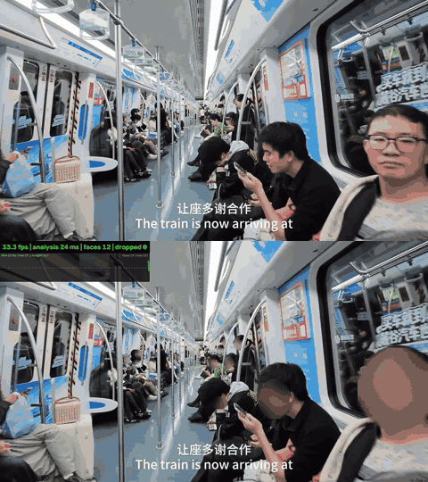

# face-blur

Blur every face in a live feed from your own Python code, or in a folder of photos, for example to anonymize footage before sharing it. Runs on a CPU, an NVIDIA GPU or the NPU of Qualcomm chips.

The four built-in models on the same night street, with tracking, the detector on every frame and a 0.5 s delay (`delay=25` frames at 50 fps). Each panel shows the time per frame on a Mac mini M4 CPU and the number of faces blurred; [15 s clip as MP4](examples/video/models_compare.mp4):


A crowded subway train, original on top, live stream below ([12 s clip as MP4](examples/video/subway_before_after.mp4)).
Setup: NVIDIA RTX 5060 Ti (`onnxruntime-gpu`), 1080p at 60 fps, no frame dropped; the overlay graphs the time per frame (dashed line: the 16.7 ms frame budget) and the face count. Config:

```python
fb = FaceBlurrer(model="yolo11n_1280", device="gpu")
live = fb.stream(fps=60, delay=30, low_score=0.2)   # delay 30 frames = 0.5 s at 60 fps
# command line: python quickstart.py --input subway.mp4 --model yolo11n_1280 --device gpu --delay 30 --low-score 0.2
```



## Quick start

```bash
pip install -r requirements.txt     # plus ffmpeg on PATH
# NVIDIA GPU (optional): pip uninstall -y onnxruntime && pip install "onnxruntime-gpu[cuda,cudnn]"
python quickstart.py --input clip.mp4                   # blur a video, show it in a window (no delay)
```

```python
from faceblur import FaceBlurrer

fb = FaceBlurrer(                   # load the model once, then reuse it; defaults shown
    # model="yolo11n_640",          # or "yolo11n_1280" (small faces), "face_det_lite", "yunet"
    # device="cpu",                 # or "gpu" (NVIDIA, onnxruntime-gpu), "npu" (Qualcomm, onnxruntime-qnn)
    # threshold=None,               # model's own confidence threshold (yolo11n 0.25)
    # method="gaussian",            # or "pixelate"
    # strength=3,                   # 1 (light) .. 3 (heavy)
    # shape="oval",                 # or "rect" (whole box)
    # pad=0.15,                     # margin around each face
    # mask=False,                   # uncomment to skip blurring: res.blurred is None, mask res.boxes yourself
)
live = fb.stream(                   # live video: detector on every frame + tracker
    fps=25,                         # nominal frame rate of your source (for the tracker)
    # delay=12,                     # uncomment for more accuracy: hold 12 frames (0.5 s at 25 fps) so
                                    #   faces the detector finds late are blurred in the earlier frames
                                    #   too; about a third fewer misses. Default 0 = no delay
    # low_score=0.1,                # detections down to this score keep a face already tracked
)

for frame in frames:                # BGR numpy arrays (H x W x 3, uint8)
    live.put(frame)                 # input side: analyse the frame, add it to the buffer
    # live.delay = 25               # change the delay any time (live.buffered: frames held now,
                                    #   live.ready: frames get() can return now)
    while (res := live.get()) is not None:   # output side: each frame with `delay` newer ones behind
        res.original                #   the input frame, unchanged
        res.blurred                 #   a blurred copy (None with mask=False)
        res.boxes                   #   the blurred faces: [(x, y, w, h), ...]
        res.scores                  #   the confidence of each face
for res in live.flush():            # with a delay, at the end: the frames still held
    ...
```

`put()` and `get()` can also run in two threads, so the output keeps a fixed frame rate when
input frames arrive unevenly. Call `live.get()` on each output tick, reuse the last result
when it returns `None` (input late), and call `live.get(force=True)` to shrink the buffer
when `live.buffered` grows too large. `live.push(frame)` is `put` then `get`.
The stream keeps only what it needs: `delay + 1` frames, the faces found in the last second
(for ByteTrack), and the faces in the held frames (for the delay). When `delay + 1` frames are
held, `put()` waits until `get()` in the other thread takes one, so no frame is dropped; called
twice in a row from one thread without a `get()`, it raises an error instead of waiting forever. Memory and time
per frame stayed the same in a 10-minute real-time run and in a simulated week of a busy camera.
To start again with no tracked faces, make a new stream with `fb.stream()`.

Images (no tracking, no delay):

```python
import cv2
from faceblur import FaceBlurrer

fb = FaceBlurrer()                  # same arguments as above
fb.blur_file("in.jpg", "out.jpg")   # an image file; returns the number of faces blurred
img = cv2.imread("in.jpg")
out = fb.blur(img)                  # a BGR array -> blurred copy
boxes = fb.detect(img)              # [(x, y, w, h), ...] if you mask the faces yourself
```

```bash
python tools/blur_images.py photos/ photos_blurred/   # a whole folder (same options as quickstart.py)
```

## Models

| `--model` | Use it for | Size | Mac M4 CPU | IQ-9075 | QCS8550 | X Elite | RB3 Gen 2 |
|---|---|---|---|---|---|---|---|
| `yolo11n_640` (default) | Most scenes, crowds included | 2.7M params, 11 MB | 24 ms | 3.7 ms | 2.9 ms | 3.1 ms | 3.2 ms |
| `yolo11n_1280` | Small, distant faces | 2.7M params, 11 MB | 67 ms | 14 ms | 12 ms | 12 ms | 18 ms |
| `face_det_lite` | Fastest on the NPU; misses small faces | 0.9M params, 3.8 MB | 18 ms | 2.7 ms | 1.9 ms | 2.0 ms | 1.4 ms |
| `yunet` | Simple scenes with a few large faces | 0.05M params, 0.2 MB | 26 ms | 0.6 to 4.6 ms | 0.5 to 4.2 ms | 0.4 to 4.0 ms | 15 to 170 ms (CPU) |

Time per frame on: Mac mini M4 (CPU, whole pipeline) · Qualcomm Dragonwing IQ-9075 EVK · QCS8550 · Snapdragon X Elite CRD · Dragonwing RB3 Gen 2 Vision Kit (QCS6490, 8-bit models). Qualcomm devices: detector on the NPU (`--device npu`), via [Qualcomm AI Hub](https://aihub.qualcomm.com).

RB3 Gen 2 runs only 8-bit (w8a8) models on its NPU, about 30x faster than its CPU (yolo11n_1280: 475 ms → 18 ms). The 8-bit models lose a little accuracy (faces left unblurred on 16 street frames, float on CPU → w8a8 on the RB3 NPU): yolo11n_1280 10.8% → 12.0%, yolo11n_640 22.9% → 26.5%, face_det_lite 51.8% → 53.0%. On the other devices the NPU matches the CPU. The repo has the 16-bit (a16w8) builds, not the 8-bit ones; [docs/hexagon.md](docs/hexagon.md#quantized-builds) lists them.

NVIDIA GPU (`--device gpu`, onnxruntime-gpu 1.32), `yolo11n_640` on 1080p frames: on an RTX 5060 Ti the detector takes 8.2 ms and the whole frame (`put()`, 30-frame delay) 10.7 ms, against 16.3 ms and 18.5 ms on the same PC's 16-core CPU (medians of 3 alternating runs of 200 frames each).

## Options

The same options exist on the command line (`quickstart.py`, `tools/`) and in Python (`FaceBlurrer(...)` and `fb.stream(...)`).

### Detection and sampling: accuracy against speed and latency

> [!IMPORTANT]
> **The two settings that matter most** (in bold below):
> - **`--model`**: `yolo11n_640` (default) or `yolo11n_1280` for small faces.
> - **`--delay FRAMES`**: hold the output this many frames so later frames fix earlier ones (default `0`; about 0.5 s worth, e.g. `12` at 25 fps, leaves about a third fewer faces unblurred). Can be changed any time (`live.delay = n`). `get()` returns a frame once `delay` newer frames are behind it.

| Command line | Python | Default | What it does | Trade-off |
|---|---|---|---|---|
| **`--model`** | `FaceBlurrer(model=)` | `yolo11n_640` | Face detector, see [Models](#models) | `yolo11n_1280`: more small faces, 3 to 4x slower |
| **`--delay FRAMES`** | `fb.stream(delay=)`, `live.delay = n` any time | `0` (none) | Hold frames so later detections fix earlier ones: a new face is followed back through the earlier frames by its lower-score detections (down to 0.1), a face found again is filled in between | `12` (0.4 s at 30 fps): a third fewer faces left unblurred on two street clips (60 → 38, 82 → 54), output 12 frames late |
| `--threshold T` | `FaceBlurrer(threshold=)` | model's own: yolo11n 0.25, face_det_lite 0.55, yunet 0.7 | Confidence a detection needs to count as a face (0 to 1) | Lower: more faces found, more false ones |
| `--min-size PX` | `FaceBlurrer(min_size=)` | `0` (`24` for yunet) | Skip faces smaller than PX pixels | Fewer false small faces, misses distant ones |
| `--low-score S` | `fb.stream(low_score=)` | `0.1` | ByteTrack second stage: detections between this and the threshold keep a known face tracked | `0` turns it off |
| `--device cpu\|gpu\|npu` | `FaceBlurrer(device=)` | `cpu` | Where the detector runs: `cpu`, `gpu` (NVIDIA, needs `pip install onnxruntime-gpu[cuda,cudnn]`) or `npu` (Qualcomm, needs `onnxruntime-qnn`). `FaceBlurrer` raises an error if the device is missing | |
| `--precision fp32\|a16w8` | `FaceBlurrer(precision=)` | `fp32` | Which build of the model runs (not for yunet). `a16w8` is quantized for the Qualcomm NPU; it also runs on `cpu` and `gpu`. In `tools/blur_live.py` it is `--npu-precision` | `a16w8`: faster on the NPU, close to fp32 |

### Blur (mask) and display

| Command line | Python | Default | What it does |
|---|---|---|---|
| **`--no-mask`** | `FaceBlurrer(mask=False)` | mask on | Do not blur at all: `res.blurred` is `None` and your app masks the faces itself from `res.boxes`. The options below are then unused, and a failed frame (`res.failed`) is not blurred either |
| `--method gaussian\|pixelate` | `FaceBlurrer(method=)` | `gaussian` | Smooth blur or pixel blocks |
| `--strength 1..3` | `FaceBlurrer(strength=)` | `3` | 1 = light, 3 = heavy |
| `--shape oval\|rect` | `FaceBlurrer(shape=)` | `oval` | Blur an oval that follows the face, or the whole box (safer) |
| `--pad F` | `FaceBlurrer(pad=)` | `0.15` | Extra margin around each face, as a fraction of its size (0 to 1; `0.4` also hides hair) |
| `--show-scores` (`quickstart.py`) | `videoio.draw_faces(frame, res.boxes, res.scores)` | off | Draw each face box with its confidence |

`quickstart.py` always draws the frame rate, analysis time and face count in the top left corner, and below them a graph of the last 300 frames: time per frame (green, against a dashed line at the frame budget, 1000 / fps) and face count (orange) (`videoio.Stats`). See [`examples/options`](examples/options) for what each blur option looks like.

```bash
python quickstart.py --input clip.mp4 --method pixelate --shape rect           # pixel blocks over the whole box (no delay)
python quickstart.py --input clip.mp4 --pad 0.4 --strength 2 --delay 12        # larger, lighter blur that also hides hair, 12-frame delay
python quickstart.py --input clip.mp4 --show-scores                            # face boxes and confidences drawn (no delay)
```

## Layout

| | |
|---|---|
| `faceblur.py` | Public API: `FaceBlurrer`, `StreamBlurrer`. The only module an app needs to import |
| `detector.py` | Face detectors (YOLO11n-face, face_det_lite, YuNet) and the blur |
| `tracker.py` | Live tracking: ByteTrack, and the delay buffer |
| `hexagon.py` | ONNX Runtime detectors: Qualcomm NPU (QNN), NVIDIA GPU (CUDA) or CPU |
| `bytetrack/` | ByteTrack (vendored, MIT) |
| `models/` | Model files |
| `quickstart.py` | Example: RTSP or file in, faceblur, live view or re-stream |
| `videoio.py` | Hardware decode / encode with ffmpeg, and the on-screen overlay, for the example |
| `tools/` | Command-line tools (`blur_images.py`, `blur_live.py`, `blur_video.py`) and NPU model scripts |

## Built with

[YOLO11Face](https://github.com/zjykzj/YOLO11Face) (YOLO11n-face, Ultralytics, AGPL-3.0) · [Qualcomm AI Hub](https://huggingface.co/qualcomm/Lightweight-Face-Detection) (Lightweight-Face-Detection) · [ByteTrack](https://github.com/FoundationVision/ByteTrack) (tracker, MIT) · [ONNX Runtime](https://onnxruntime.ai/) (runs the models on CPU, NVIDIA CUDA or Qualcomm QNN) · [OpenCV](https://opencv.org/) (YuNet detector, blurring, image and video reading)
