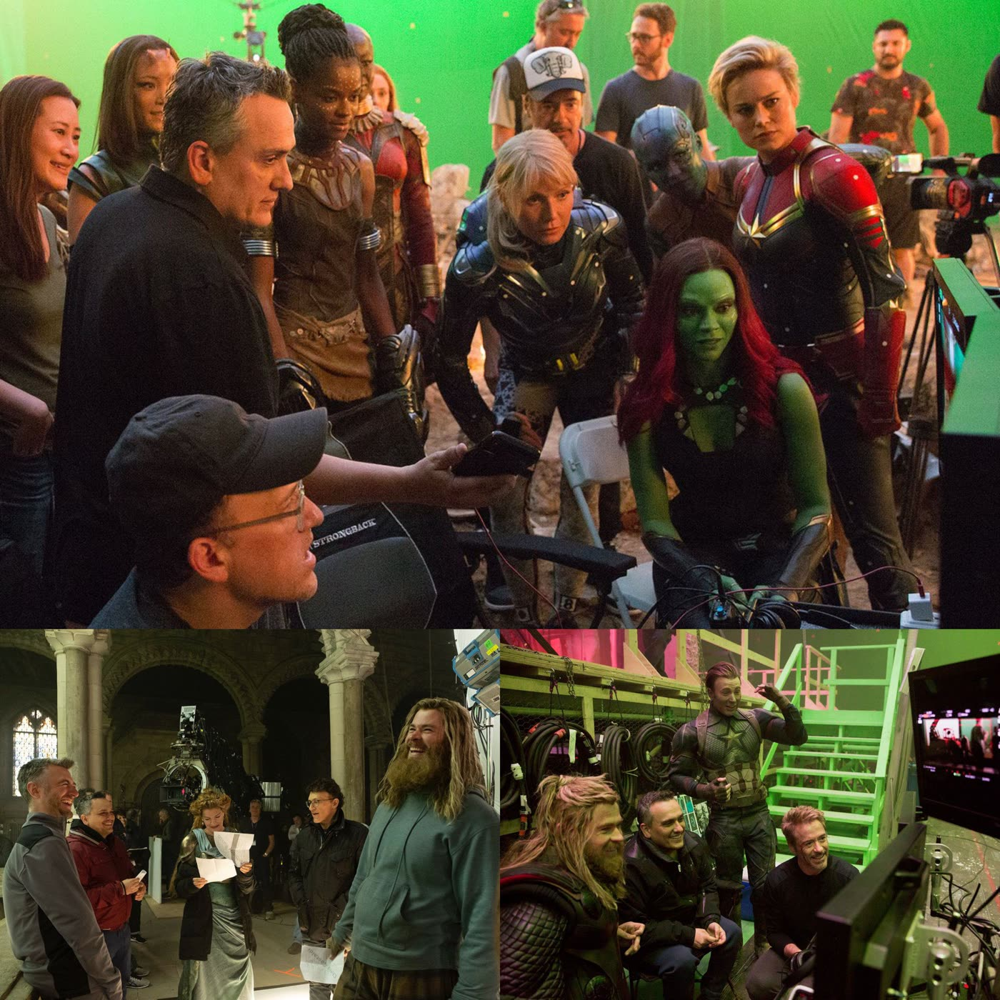
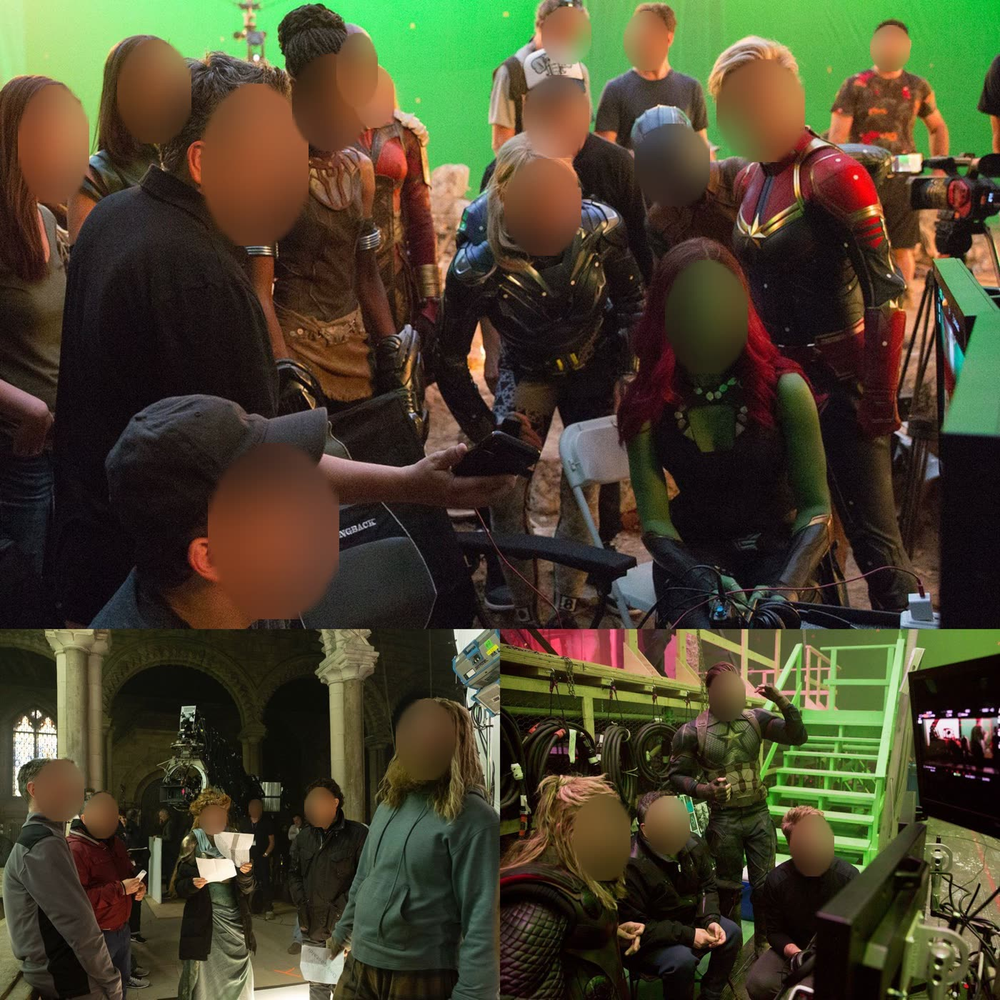
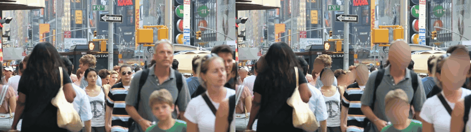

# face-blur

Blur every face in a folder of photos or videos, for example to anonymize a research dataset before sharing it.

| Before | After |
|:-:|:-:|
|  |  |

**Video** (left: original, right: blurred; [full clip as MP4](examples/video/street_before_after.mp4)):



## Quick start

**Linux / macOS**

```bash
git clone https://github.com/duclvq/face-blur.git
cd face-blur
./run.sh ~/photos/dataset          # a folder of images  -> ~/photos/dataset_blurred
./run.sh ~/videos/clips            # a folder of videos  -> ~/videos/clips_blurred
./run.sh ~/videos/party.mp4        # one video           -> ~/videos/party_blurred.mp4
```

**Windows**

```bat
run.bat C:\photos\dataset
run.bat C:\videos\party.mp4
```

The first run sets itself up, which takes a few minutes.

## Models

| `--model` | When to use it |
|---|---|
| `yunet` (default) | Fast, works on any machine, fast enough for live video. Misses small faces. |
| `raccoon_s` | Best results. Finds small and hard-to-see faces, and in videos follows faces from frame to frame. Much slower. |
| `raccoon_l` | Like `raccoon_s`, larger and slower. |

The raccoon models come from [InsightFace](https://github.com/deepinsight/insightface) and are for **non-commercial research only**; YuNet is MIT-licensed. The examples above were made with `--model raccoon_s`.

## Options

Add them after the input (and optional output folder):

```bash
./run.sh ~/photos/dataset ~/photos/out --model raccoon_s --method pixelate
```

| Option | Default | What it does |
|---|---|---|
| `--model` | `yunet` | Face detector, see above |
| `--method gaussian\|pixelate` | `gaussian` | Smooth blur or pixel blocks |
| `--strength 1..3` | `3` | 1 = light, 3 = heavy |
| `--shape oval\|rect` | `oval` | Blur an oval around the face, or the whole box (safer) |
| `--pad 0..1` | `0.15` | Extra margin around each face (`0.4` also hides hair) |
| `--min-size N` | `24` (off for raccoon) | Skip faces smaller than N pixels |
| `--cpu` | off | Don't use the GPU. By default an NVIDIA or Apple GPU is used when there is one, else the CPU |
| `--analysis-fps N` | `15` | Videos, raccoon: face scans per second. Use `30` for fast motion |

See [`examples/options`](examples/options) for what each option looks like.

## Output

- Your originals are never changed. Results go to a separate folder with the same structure.
- `blur_report.csv` lists how many faces were found in each file.
- Videos keep their format, frame rate, size, sound and subtitles (needs [ffmpeg](https://ffmpeg.org/download.html)).

No face detector is perfect. Check a sample of the output by hand before sharing.

## Live streams

`blur_stream.py` blurs a webcam, an RTSP/RTMP/HTTP stream or a file as it plays, with YuNet:

```bash
.venv/bin/python blur_stream.py 0 --show                              # webcam, preview window
.venv/bin/python blur_stream.py rtsp://camera/stream out.mp4          # camera to a file
.venv/bin/python blur_stream.py rtsp://camera/stream rtmp://server/live  # re-stream
```

Between detections it follows faces with optical flow. Output is delayed by `--delay` seconds (default `0.5`), so a face is blurred from its first frame, not from when it is first detected. `--delay 0` leaves more faces exposed. If the machine is too slow, frames are dropped, never sent unblurred. No sound.

## Running the scripts directly

```bash
pip install -r requirements.txt
python blur_faces.py INPUT_DIR OUTPUT_DIR [options]   # images
python blur_video.py INPUT OUTPUT [options]           # a video or a folder of videos
```

For an NVIDIA GPU: `pip uninstall -y onnxruntime && pip install -r requirements-gpu.txt` (driver 580 or newer). `run.sh` and `run.bat` do this by themselves.

## Built with

[InsightFace](https://github.com/deepinsight/insightface) (SCRFD face detector, PrivateFrame video tracking) · [ONNX Runtime](https://onnxruntime.ai/) (runs the models on CPU, NVIDIA CUDA or Apple CoreML) · [OpenCV](https://opencv.org/) (YuNet detector, blurring, image and video reading) · [ffmpeg](https://ffmpeg.org/) (video encoding, keeps sound and format)
