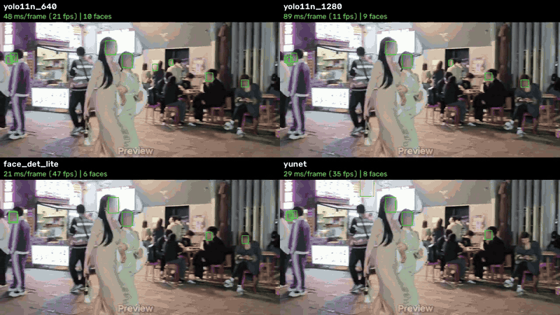

# face-blur

Blur every face in a live feed from your own Python code, or in a folder of photos, for example to anonymize footage before sharing it. Runs on a CPU or on the NPU of Qualcomm chips.

The four built-in models on the same night street, with tracking, the detector on every frame and a 0.5 s delay (`delay=25` frames at 50 fps). Each panel shows the time per frame on a Mac mini M4 CPU and the number of faces blurred; [15 s clip as MP4](examples/video/models_compare.mp4):



## Quick start

```bash
pip install -r requirements.txt     # plus ffmpeg on PATH
python quickstart.py --input clip.mp4                   # blur a video, show it in a window (no delay)
```

```python
from faceblur import FaceBlurrer

fb = FaceBlurrer(                   # load the model once, then reuse it; defaults shown
    # model="yolo11n_640",          # or "yolo11n_1280" (small faces), "face_det_lite", "yunet"
    # threshold=None,               # model's own confidence threshold (yolo11n 0.3)
    # tiles=1,                      # N x N extra tiles for small faces
    # method="gaussian",            # or "pixelate"
    # strength=3,                   # 1 (light) .. 3 (heavy)
    # shape="oval",                 # or "rect" (whole box)
    # pad=0.15,                     # margin around each face
    # mask=False,                   # uncomment to skip blurring: res.blurred is None, mask res.boxes yourself
)
live = fb.stream(                   # live video: detector + tracker between frames
    fps=25,                         # frame rate of your source (needed to turn seconds into frames)
    # detect_every=3,               # uncomment for lower latency (2 or 3): detector on every 2nd or
                                    #   3rd frame only, faces moved by tracking in between (2 to 3x less
                                    #   work per frame). Default 1 = detector on every frame (most accurate)
    # delay=12,                     # uncomment for more accuracy: push() returns the frame from 12 frames
                                    #   ago (0.5 s at 25 fps), fixed with what was seen since (faces found
                                    #   late are blurred back in time): ~half the misses. Default 0 = no delay
    # hold=0.3,                     # seconds a face stays blurred after the detector loses it
)

for frame in frames:                # BGR numpy arrays (H x W x 3, uint8)
    res = live.push(frame)          # this frame (with delay=12: the frame 12 frames earlier)
    if res is None:                 # only with a delay: buffer still filling
        continue
    res.original                    # the input frame, unchanged
    res.blurred                     # a blurred copy (None with mask=False)
    res.boxes                       # the blurred faces: [(x, y, w, h), ...]
    res.scores                      # the confidence of each face
for res in live.flush():            # with a delay, at the end: the frames still held
    ...
```

## Models

| `--model` | Use it for | Mac M4 CPU | IQ-9075 | QCS8550 | X Elite | RB3 Gen 2 |
|---|---|---|---|---|---|---|
| `yolo11n_640` (default) | Most scenes, crowds included | 24 ms | 3.7 ms | 2.9 ms | 3.1 ms | 3.0 ms |
| `yolo11n_1280` | Small, distant faces | 67 ms | 14 ms | 12 ms | 12 ms | 475 ms (CPU) |
| `face_det_lite` | Fastest on the NPU; misses small faces | 18 ms | 2.7 ms | 1.9 ms | 2.0 ms | 1.4 ms |
| `yunet` | Simple scenes with a few large faces | 26 ms | 0.6 to 4.6 ms | 0.5 to 4.2 ms | 0.4 to 4.0 ms | 15 to 170 ms (CPU) |

Time per frame on: Mac mini M4 (CPU, whole pipeline) · Qualcomm Dragonwing IQ-9075 EVK · QCS8550 · Snapdragon X Elite CRD · Dragonwing RB3 Gen 2 Vision Kit (QCS6490, 8-bit models). Qualcomm devices: detector on the NPU, via [Qualcomm AI Hub](https://aihub.qualcomm.com).

## Options

The same options exist on the command line (`quickstart.py`, `tools/`) and in Python (`FaceBlurrer(...)` and `fb.stream(...)`).

### Detection and sampling: accuracy against speed and latency

> [!IMPORTANT]
> **The three settings that matter most** (in bold below):
> - **`--model`**: `yolo11n_640` (default) or `yolo11n_1280` for small faces.
> - **`--detect-every N`**: run the detector every N frames (default `1`); raise it on a slow machine.
> - **`--delay FRAMES`**: hold the output this many frames so later frames fix earlier ones (default `0`; about 0.5 s of frames, e.g. `12` at 25 fps, leaves about half as many faces unblurred).

| Command line | Python | Default | What it does | Trade-off |
|---|---|---|---|---|
| **`--model`** | `FaceBlurrer(model=)` | `yolo11n_640` | Face detector, see [Models](#models) | `yolo11n_1280`: more small faces, 3 to 4x slower |
| **`--detect-every N`** | `fb.stream(detect_every=)` | `1` | Run the detector every N frames; tracking moves faces in between | N times less detector work; misses more fast or new faces |
| **`--delay FRAMES`** | `fb.stream(delay=)` | `0` (none) | Hold frames so later detections fix earlier ones: a new face is followed back to the frames the detector missed, a face found again is filled in between | `12` at 25 fps (0.5 s): about half as many faces left unblurred, output 0.5 s late |
| `--threshold T` | `FaceBlurrer(threshold=)` | model's own: yolo11n 0.3, face_det_lite 0.55, yunet 0.7 | Confidence a detection needs to count as a face (0 to 1) | Lower: more faces found, more false ones |
| `--tiles N` | `FaceBlurrer(tiles=)` | `1` (off) | Also detect on an N x N grid of overlapping tiles, so small faces are seen larger | 1 + N×N detector runs per frame. Helps `face_det_lite`; YOLO rarely needs it |
| `--min-size PX` | `FaceBlurrer(min_size=)` | `0` (`24` for yunet) | Skip faces smaller than PX pixels | Fewer false small faces, misses distant ones |
| `--hold SEC` (`blur_live.py`) | `fb.stream(hold=)` | `0.3` | A face the detector lost stays blurred this long, following optical flow | Longer: fewer flickers, blur may stay after the face has gone |
| `--low-score S` (`blur_live.py`) | `fb.stream(low_score=)` | `0.3` | ByteTrack second stage: detections between this and the threshold keep a known face tracked | `0` turns it off |
| `--cpu` | `FaceBlurrer(gpu=False)` | off | Detector on the CPU only, never the Qualcomm NPU | |

### Blur (mask) and display

| Command line | Python | Default | What it does |
|---|---|---|---|
| **`--no-mask`** | `FaceBlurrer(mask=False)` | mask on | Do not blur at all: `res.blurred` is `None` and your app masks the faces itself from `res.boxes`. The options below are then unused, and a failed frame (`res.failed`) is not blurred either |
| `--method gaussian\|pixelate` | `FaceBlurrer(method=)` | `gaussian` | Smooth blur or pixel blocks |
| `--strength 1..3` | `FaceBlurrer(strength=)` | `3` | 1 = light, 3 = heavy |
| `--shape oval\|rect` | `FaceBlurrer(shape=)` | `oval` | Blur an oval that follows the face, or the whole box (safer) |
| `--pad F` | `FaceBlurrer(pad=)` | `0.15` | Extra margin around each face, as a fraction of its size (0 to 1; `0.4` also hides hair) |
| `--show-scores` (`quickstart.py`) | `videoio.draw_faces(frame, res.boxes, res.scores)` | off | Draw each face box with its confidence |

`quickstart.py` always draws the frame rate, analysis time and face count in the top left corner (`videoio.Stats`). See [`examples/options`](examples/options) for what each blur option looks like.

```bash
python quickstart.py --input clip.mp4 --method pixelate --shape rect           # pixel blocks over the whole box (no delay)
python quickstart.py --input clip.mp4 --pad 0.4 --strength 2 --delay 12        # larger, lighter blur that also hides hair, 12-frame delay
python quickstart.py --input clip.mp4 --show-scores                            # face boxes and confidences drawn (no delay)
```

## Layout

| | |
|---|---|
| `faceblur.py` | Public API: `FaceBlurrer`, `StreamBlurrer`. The only module an app needs to import |
| `detector.py` | Face detectors (YOLO11n-face, face_det_lite, YuNet) and the blur |
| `tracker.py` | Live tracking: ByteTrack + optical flow, and the delay buffer |
| `hexagon.py` | Qualcomm NPU (QNN) detectors |
| `bytetrack/` | ByteTrack (vendored, MIT) |
| `models/` | Model files |
| `quickstart.py` | Example: RTSP or file in, faceblur, live view or re-stream |
| `videoio.py` | Hardware decode / encode with ffmpeg, and the on-screen overlay, for the example |
| `tools/` | Command-line tools (`blur_images.py`, `blur_live.py`, `blur_video.py`) and NPU model scripts |

## Built with

[YOLO11Face](https://github.com/zjykzj/YOLO11Face) (YOLO11n-face, Ultralytics, AGPL-3.0) · [Qualcomm AI Hub](https://huggingface.co/qualcomm/Lightweight-Face-Detection) (Lightweight-Face-Detection) · [ByteTrack](https://github.com/FoundationVision/ByteTrack) (tracker, MIT) · [ONNX Runtime](https://onnxruntime.ai/) (runs the models on CPU or Qualcomm QNN) · [OpenCV](https://opencv.org/) (YuNet detector, blurring, image and video reading)
