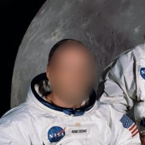
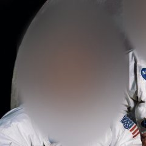

# face-blur

Detect faces in every image of a dataset folder and blur them, for example to anonymize a dataset before sharing it.

## Install

Requires Python 3.8+.

```bash
git clone https://github.com/duclvq/face-blur.git
cd face-blur
pip install -r requirements.txt
```

## Windows quick start

Double-click is not enough; give it a folder. Either drag your dataset folder onto `run.bat`, or run:

```bat
run.bat C:\path\to\dataset
run.bat C:\path\to\dataset C:\path\to\output --method pixelate
```

On the first run `run.bat` sets everything up by itself: it finds Python (installing Python 3.12 with `winget` if it is missing), creates a private `.venv` folder next to the script and installs OpenCV into it. Later runs start straight away. If no output folder is given, results go to `DATASET_blurred`. Delete `.venv` to force a clean reinstall.

## Linux / macOS quick start

```bash
./run.sh ~/photos/dataset                              # a folder of images
./run.sh ~/videos/clips                                # a folder of videos
./run.sh ~/videos/party.mp4                            # one video -> party_blurred.mp4
./run.sh ~/photos/dataset ~/photos/out --method pixelate --gpu
```

Like `run.bat`, the first run creates a private `.venv` next to the script (with `uv` if it is installed, otherwise `python3 -m venv`; on Debian/Ubuntu that needs `sudo apt install python3-venv`) and installs the requirements. It picks `blur_faces.py` or `blur_video.py` from what the input contains. Without an output, results go to `FOLDER_blurred` or `NAME_blurred.EXT` next to the input. With `--gpu` it also installs the GPU packages, if `nvidia-smi` finds an NVIDIA GPU; otherwise it warns and runs on the CPU.

## Usage

```bash
python blur_faces.py INPUT_DIR OUTPUT_DIR
```

Options:

| Option | Default | Description |
|---|---|---|
| `--method gaussian\|pixelate` | `gaussian` | Blur style |
| `--strength 1..3` | `3` | 1 = light, 3 = heavy |
| `--min-size N` | `24` | Smallest face to detect, in pixels |
| `--shape oval\|rect` | `oval` | Blur an oval that follows the face, or the whole box |
| `--pad N` | `0.15` | Margin around each face, as a fraction of its size, 0 to 1 (0 = tight). Not pixels: large values blur the whole image |
| `--gpu` | off | Detect faces on an NVIDIA GPU (see [NVIDIA GPU](#nvidia-gpu)) |

Example:

```bash
python blur_faces.py ./my_dataset ./my_dataset_blurred --method pixelate
```

## Choosing settings

### Quick picks

| I want… | Add these options |
|---|---|
| A natural-looking blur for most datasets | *(none, the defaults)* |
| Stronger privacy: also hide hair and the face outline | `--shape rect --pad 0.4` |
| Pixel blocks instead of a smooth blur | `--method pixelate` |
| Crowds or wide shots with small faces in the back | `--min-size 12` |
| A light blur that keeps the rough expression (not anonymous) | `--strength 1` |
| A quick preview of a long video | `--detect-every 3` (with `blur_video.py`) |

For example: `python blur_faces.py ./my_dataset ./my_dataset_blurred --shape rect --pad 0.4`

Small faces: the default `--min-size 24` skips any face narrower than 24 px. In a crowd photo where faces are 12–20 px wide, the defaults blur nothing at all. Lower `--min-size`, and check `blur_report.csv` for images with 0 faces that should have some.

### What each option looks like

Every image below was made from the same photo (`examples/input/team/S69-31739.jpg`). Only the option named under it changes; everything else is the default.

**`--method` and `--strength`**

| Original | `gaussian` 1 | `gaussian` 2 | `gaussian` 3 (default) |
|:-:|:-:|:-:|:-:|
|  |  |  |  |

| | `pixelate` 1 | `pixelate` 2 | `pixelate` 3 |
|:-:|:-:|:-:|:-:|
| |  |  |  |

Strength 1 is a light blur: a face may still be recognizable. Use 3 when the goal is anonymity.

**`--shape`**

| `oval` (default) | `rect` |
|:-:|:-:|
|  |  |

**`--pad`**: margin around each face, as a fraction of the face size

| `0` | `0.15` (default) | `0.4` | `1` |
|:-:|:-:|:-:|:-:|
|  |  |  |  |

`--pad 1` already covers three times the width of the face. In a group photo the patches merge, so keep it at 0.5 or less. Values above 1 are refused.

## Output

Your original images are never modified: results are always written to a separate `OUTPUT_DIR` (the script refuses to write into `INPUT_DIR`). If `OUTPUT_DIR` already has files with the same names, they are replaced.


- `OUTPUT_DIR` mirrors the folder structure of `INPUT_DIR`. Every image is written out, and images without faces are unchanged.
- `OUTPUT_DIR/blur_report.csv` lists how many faces were found in each file, what share of the image was blurred (`blurred_pct`), and any files that could not be read. Images where more than half the frame is blurred are flagged with a warning while the script runs.

Supported formats: jpg, jpeg, png, bmp, webp, tif, tiff.

## Videos

`blur_video.py` does the same for videos, using the same detector and blur:

```bash
python blur_video.py INPUT OUTPUT [options]
python blur_video.py ./clips ./clips_blurred                 # a folder (structure is mirrored)
python blur_video.py party.mp4 ./blurred                     # one video into a folder
python blur_video.py party.mp4 party_blurred.mp4 --method pixelate
```

It takes the same `--method`, `--strength`, `--min-size`, `--shape` and `--pad` options, plus:

| Option | Default | Description |
|---|---|---|
| `--detect-every N` | `1` | Look for faces every N frames and reuse the boxes in between. Faster, but a fast-moving or newly appearing face can be unblurred for up to N-1 frames |
| `--hold N` | `10` | Keep blurring a face for N frames after the detector loses it, so a missed frame does not flash an unblurred face (0 = off) |

- Formats: mp4, mov, avi, mkv, webm, m4v. Output keeps the name, extension, frame rate and frame size of the input.
- **Same format as the input:** install [ffmpeg](https://ffmpeg.org/download.html) and put it on your PATH. The video is then re-encoded in the codec it came in, with the same profile, pixel format (e.g. 10-bit, 4:2:2), codec tag and colour tags. Audio, subtitles and metadata are copied untouched. Supported: H.264, HEVC/H.265, VP8, VP9, AV1, MPEG-4 Part 2 (XviD/DivX), MPEG-2, Motion JPEG and ProRes, plus any other codec your ffmpeg can encode. A codec ffmpeg cannot encode falls back to H.264 with a warning and a note in the report.
- **Without ffmpeg** the script warns, drops the sound, and lets OpenCV write the video, trying the source codec first.
- Frames go through 8-bit RGB for the blur, so a 10-bit or HDR source keeps its format and tags but not its extra bit depth.
- As with images, the script refuses to write into the input folder or over the input file.
- `OUTPUT/blur_report.csv` (for a single video: `NAME_report.csv` next to the output) has one row per video: frame count, fps, size, frames with a blurred face, the most faces in one frame, how much of the picture was blurred (`max_blurred_pct`, `mean_blurred_pct`), the video codec (`h264`, or `theora -> h264` if it had to change), the encoder used, and whether the audio was kept. A warning is printed when more than half of a frame is blurred.
- Decoding, face detection, and blurring + encoding run at the same time on consecutive frames. Speed on an Apple M4 laptop (CPU): about 16 frames per second for 1080p (29 with `--detect-every 3`); with an NVIDIA GPU see below.

## NVIDIA GPU

`--gpu` runs face detection on an NVIDIA GPU with [onnxruntime](https://onnxruntime.ai/) (CUDA), using the same YuNet model: on the test set it finds the same faces as the CPU, with boxes within 1 px. For videos it also encodes on the GPU (NVENC) when the source is H.264, HEVC or AV1 and the GPU can produce the same profile and pixel format; otherwise the CPU encoder keeps the format (for example 10-bit H.264, which consumer NVENC cannot encode).

```bash
pip install -r requirements-gpu.txt      # onnxruntime-gpu plus CUDA/cuDNN from pip
python blur_video.py --gpu ./clips ./clips_blurred
python blur_faces.py --gpu ./dataset ./dataset_blurred
```

Only an NVIDIA driver is needed; CUDA and cuDNN come from pip. Current onnxruntime-gpu releases use CUDA 13 (driver 580 or newer); for an older driver, install `onnxruntime-gpu==1.26.0`, the last CUDA 12 build, with CUDA 12 and cuDNN 9 libraries on the PATH. If anything is missing, `--gpu` prints a warning and runs on the CPU.

Measured on a Windows PC with an Intel i5-14400F and an RTX 5060 Ti:

| Job | CPU | `--gpu` | Speed-up |
|---|---|---|---|
| Face detection, 1920 px photo | 54 ms | 9 ms | 5.7x |
| Face detection, 3840 px photo | 241 ms | 42 ms | 5.7x |
| 1080p video, 500 frames, H.264 with audio | 16.5 fps | 66 fps | 4x |
| 1080p video with `--detect-every 3` | 36 fps | | |
| 250 photos, 1920x1080, same camera | 13.7 s | 6.0 s | 2.3x |
| 35 photos in 13 different sizes | 3.0 s | 3.4 s | (stays on CPU) |

On the CPU, face detection is the limit: it does not get faster with more than a few cores, so a CPU run keeps the machine about two-thirds busy rather than at 100%. On Intel CPUs with performance and efficiency cores (12th gen and newer), Windows may move a run whose window is minimized or in the background onto the efficiency cores only, which made the CPU runs above about 2.5x slower in testing. Keep the window in the foreground, or use the High performance power plan, for long batches.

The first image of each new size costs the GPU a few seconds of cuDNN set-up. `blur_faces.py --gpu` therefore moves a size to the GPU only after 20 images of that size, so a dataset of mixed sizes runs at CPU speed and a dataset from one camera gets the speed-up. Videos have one size and use the GPU from the first frame.

## Examples

See [`examples/`](examples/): a sample dataset in `examples/input` and the blurred results in `examples/output` and `examples/output_pixelate`. The option previews above are in `examples/options`.

## Performance

Measured on an Apple M4 laptop (CPU only, no GPU needed):

| Photo width | Face detection | Blurring 7 faces |
|---|---|---|
| 640 px | ~9 ms | ~14 ms |
| 1920 px | ~56 ms | ~24 ms |
| 4000 px | ~310 ms | ~100 ms |

A batch of 200 photos (~1280 px, 850 faces) takes about 12 seconds including loading and saving, roughly 1,000 photos per minute. Older or low-power PCs will be slower.

## Face detector

[YuNet](https://github.com/opencv/opencv_zoo/tree/main/models/face_detection_yunet), a 230 KB neural network bundled in `models/` (MIT license), run through OpenCV. It handles tilted, turned and small faces well. On group photos with 20-120 people it found the same faces as RetinaFace-ResNet50 while running about 30x faster on CPU.

No detector is perfect. If you need strict anonymization, review a sample of the output by hand.
